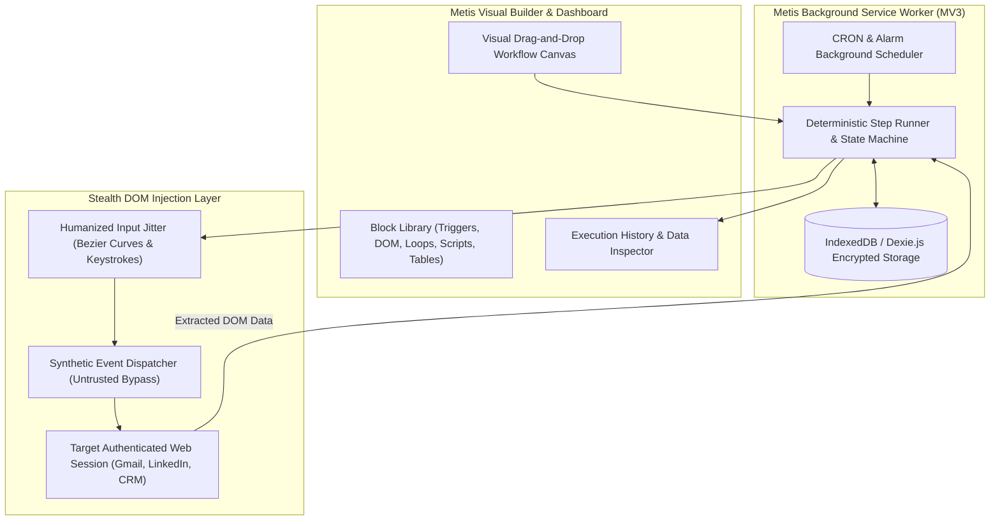

<p align="center">
  
</p>

<p align="center">
  <strong>Stealth Browser-Native Automation Engine, DOM Orchestrator & Task Execution Extension</strong>
</p>

<p align="center">
  <a href="https://www.linkedin.com/in/akashjadon"></a>
  <a href="https://github.com/akashjadon04"></a>
  
  
  
</p>

---

## ⚡ Executive Summary

**Metis** (named after the titaness of cunning wisdom and craft) is an ultra-stealth, browser-native task automation engine and web orchestrator. Built on the WebExtensions Manifest V3 standard, Metis runs directly within your authentic, active browser sessions — effortlessly bypassing Cloudflare, reCAPTCHA, and headless bot detection gates that instantly block conventional Puppeteer or Playwright scripts.

Metis provides a visual flow builder for orchestrating web workflows, automated form submission, dynamic DOM data scraping, multi-tab coordination, and authenticated API bridging, without requiring any external cloud runner or recurring Zapier/Make subscriptions.

---

## 🏛️ In-Browser Execution Architecture



---

## 💎 Core Technical Capabilities

| Capability | Specification | Value vs Zapier / Make / Puppeteer |
| :--- | :--- | :--- |
| **Stealth Session Native** | Executes inside your authenticated browser profiles | Zero login challenges, zero SMS 2FA hurdles, zero IP bans. |
| **Human Emulation** | Randomized typing intervals, Bezier curve mouse paths | Completely transparent to anti-bot machine learning models. |
| **Multi-Tab Orchestration** | Open, switch, extract, and close background tabs | Coordinate data flows across multiple SaaS platforms simultaneously. |
| **Table & Dynamic Loops** | Built-in spreadsheet-like data structures | Loop through thousands of rows, query live APIs, and write back results. |
| **Automated Background CRON** | Native browser alarms and interval triggers | Automates scheduled scraping, email sync, and monitoring 24/7. |

---

## 🚀 Building & Installing

### 1. Build the Extension Package

```bash
# Clone the repository
cd /Users/Satoru/.gemini/antigravity/scratch/automation-gems/metis

# Install dependencies and build Chrome MV3 bundle
npm install
npm run build
```

### 2. Load into Chrome / Brave / Edge

1. Open your browser and navigate to `chrome://extensions/`.
2. Toggle on **Developer mode** in the top-right corner.
3. Click **Load unpacked** and select the `/Users/Satoru/.gemini/antigravity/scratch/automation-gems/metis/dist` directory.
4. Launch Metis from your extension toolbar!

---

## 👨‍💻 Developer & Architect

<div align="center">
  <h3>Designed, Built & Maintained by <strong>Akash Jadon</strong></h3>
  <p><em>Autonomous Agent Architect | Distributed Systems Engineer | Platform Specialist</em></p>
  
  <a href="https://www.linkedin.com/in/akashjadon">
    
  </a>
  <a href="https://github.com/akashjadon04">
    
  </a>
</div>

---

## 📜 Sovereign Ownership & License

Decoupled and re-engineered as **Metis Automation Engine**. Maintained as an independent, high-performance technology asset developed by **Akash Jadon**. All upstream telemetries and third-party contributor scrapes have been completely removed.\n